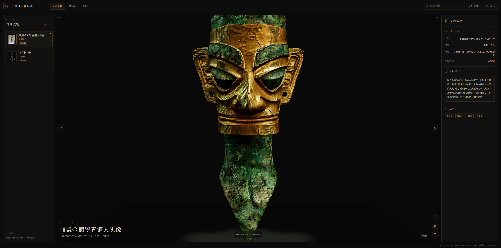
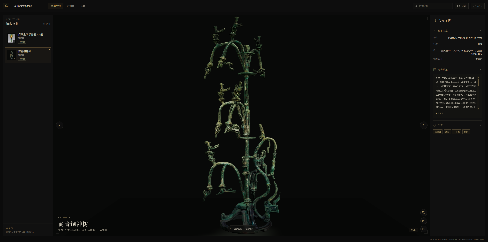

# 三星堆数字博物馆

这是一个个人学习性质的非官方数字展示项目，使用浏览器展示本地 GLB 文物模型。你可以跟随本教程从文物图片开始，准备 3D 模型并添加到博物馆。无需预先掌握 Blender 或专业 3D 建模知识。

文物史料仅在可靠来源核实后填写。AI 辅助生成的图片和三维模型可能与真实文物存在差异，只用于数字展示。

## 项目截图

下图展示青铜人头像和青铜神树在 3D 浏览页面中的效果。

<p align="center">
  
  
</p>

## 快速启动

在项目根目录执行：

```sh
npm install --prefix references
npm --prefix references run dev
```

在终端输出的本地地址打开网站，通常是 `http://localhost:5173`。构建、测试和文物数据校验命令：

```sh
npm --prefix references run build
npm --prefix references test
npm --prefix references run artifacts:validate
```

开发启动和生产构建前也会自动校验文物数据及本地资源。

## 新手教程：从图片到 3D 文物

整体流程：**准备文物图片 → 整理建模参考图 → 生成并检查 GLB → 将模型加入本项目 → 填写文物资料并校验**。

### 1. 准备文物图片

从[三星堆博物馆官网](https://www.sxd.cn/)等可靠来源查找文物图片。优先选择主体完整、造型清晰、遮挡较少的图片，并留意来源页面和素材使用条款。截图也可以作为个人制作参考。

### 2. 整理建模参考图

可以使用 ChatGPT 等图片工具清理背景或生成更清晰的正面参考图。可参考以下提示词：

> 请根据我上传的文物照片，制作一张适合 AI 3D 建模参考的清晰正视图。尽可能保留照片中可见的文物外观、造型、颜色和纹理，完整呈现主体，移除背景、展台及干扰元素。不要增加或删除可见结构；对于原图中看不到的部分，不要推测或补造细节。请输出高分辨率图片。

生成图片可能会改变细节，使用前应与原始照片逐项对照。不要把 AI 补出的部分当作文物史实。

### 3. 生成并检查 3D 模型

在 [Tripo](https://www.tripo3d.ai/) 等图像转 3D 工具中选择 Image to 3D，上传参考图并生成模型。预览模型的正面、侧面和背面，检查明显变形、缺失结构和纹理问题；满意后导出为 `.glb`。平台功能、模型选项和导出条件以其当前界面为准。

GLB 文件放入项目根目录的 `public/models/`。该目录中的模型会被项目自动发现并加入模型清单。

### 4. 把模型加入本项目

本仓库已经包含博物馆网页和运行配置，无需重新创建项目或克隆 3DCellForge。把导出的模型复制到 `public/models/`，把对应缩略图复制到 `public/images/artifacts/`。建议模型和图片使用相同文件主名，例如：

```text
public/models/new-artifact.glb
public/images/artifacts/new-artifact.webp
```

之后按照下一节添加文物记录。项目使用 React、Vite、Three.js、React Three Fiber 和 Drei 展示模型；3DCellForge 是相关交互和渲染技术的参考项目。

### 5. 添加文物资料

每件文物的元数据和介绍统一保存在 `references/src/data/artifacts/<id>.md`。YAML Front Matter 保存结构化字段，Markdown 正文保存介绍；这里是唯一维护中的文物数据源，运行时直接读取，不再使用 `artifacts.json` 或独立的 `data/content/<id>.md`。

新增记录有两种方式：

**批量导入：**复制 `references/data/artifact-import-template.csv` 并填写一行一件文物。填写 `modelFile`、`name`、`sourceUrl`、`category`、`thumbnailFile` 等列；未知资料留空，CSV 列名不要修改。在项目根目录运行：

```sh
npm --prefix references run artifacts:import -- --input data/my-artifacts.csv
npm --prefix references run artifacts:validate
```

导入脚本按 GLB 文件名生成稳定 ID，关联本地模型和缩略图，并创建或更新 Markdown 文件。它不会访问来源网页或撰写历史资料；更新已有记录时会保留正文。新记录正文为空，需人工补充。

**手动新增：**复制 `references/src/data/artifacts/` 中的一份 Markdown 文件，以新的稳定 ID 命名，修改 Front Matter 和正文。不要改动已存在文物的 ID、模型路径或展示配置，除非确实需要调整对应模型。

字段和内容示意：

```md
---
id: new-artifact
name: 文物名称
modelFile: new-artifact.glb
modelPath: /models/new-artifact.glb
thumbnailPath: /images/artifacts/new-artifact.webp
category: ''
sourceUrl: ""
sourceVerified: false
pendingVerification:
  - sourceUrl
  - category
keywords: []
modelPosition: [0, 0, 0]
modelRotation: [0, 0, 0]
modelScale: 1
cameraPosition: [0, 0.12, 5.2]
contentPath: ./artifacts/new-artifact.md
contentStatus: pending
---

# 文物名称

## 文物介绍

填写已由可靠来源核实的内容。
```

应以现有文物文件的字段结构为准：保留适用的模型、相机和展示配置字段。未知史实、年代、尺寸、材质或来源保持空白，并列入 `pendingVerification`；来源尚未核实前保持 `sourceVerified: false`。正文补齐并核实后，可移除 `contentStatus: pending`。不要让 AI 推测缺失资料。

每次新增或修改文物后运行：

```sh
npm --prefix references run artifacts:validate
```

校验会检查 YAML 格式、数据类型、ID、模型清单和本地图片/模型资源路径。错误字段或缺少资源会导致校验失败；待核实信息会作为提示列出。

旧版 checkout 若还保留 `artifacts.json` 和分离正文文件，可先运行 `npm --prefix references run artifacts:migrate` 预览一次性迁移报告，再使用 `npm --prefix references run artifacts:migrate -- --write` 写入。目标 Markdown 文件已存在时会跳过，不覆盖人工修改。当前版本无需运行此迁移。

## 参考工具与项目

| 工具或项目 | 用途 |
|---|---|
| [ChatGPT](https://chatgpt.com/) | 辅助整理图片参考；生成结果需人工核对 |
| [Tripo](https://www.tripo3d.ai/) | 图像转 3D 并导出 GLB，具体功能以平台当前版本为准 |
| [Claude Code](https://code.claude.com/) / [Codex](https://openai.com/codex/) | AI 辅助开发和维护网页 |
| [3DCellForge](https://github.com/huangserva/3DCellForge) | GLB 展示与交互技术参考，MIT License |
| [三星堆博物馆官网](https://www.sxd.cn/) | 文物资料参考；以馆方公开信息为准 |

## 说明

本项目仅用于个人学习和技术交流，并非三星堆博物馆官方项目。发布前请核实图片、文物介绍及 3D 资产的来源和授权，并按要求标明来源。AI 生成的模型不代表专业考古三维扫描结果。

感谢 [3DCellForge](https://github.com/huangserva/3DCellForge) 及作者 [@servasyy_ai](https://x.com/servasyy_ai) 提供 3D 展示技术参考。
